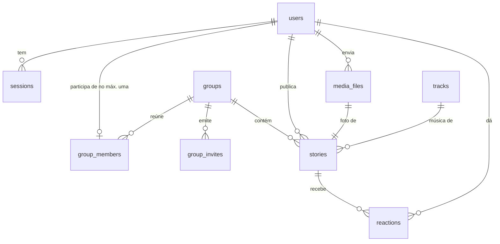

# Modelo de dados e regras

## Modelo de dados

Todas as datas são **segundos Unix (UTC)** guardados como `INTEGER`. Ids públicos são aleatórios de 128 bits (hex).

| Tabela | Módulo | O que guarda | Restrições que importam |
|---|---|---|---|
| `users` | auth | e-mail, nome, hash argon2id | `email` único (sem diferenciar maiúsculas) |
| `sessions` | auth | **hash SHA-256** do token, expiração, revogação | `token_hash` único; só vale se `revoked_at IS NULL` e `expires_at > agora` |
| `groups` | groups | nome da roda, criador | — |
| `group_members` | groups | quem está em qual roda, papel (`owner`/`member`) | **`user_id` é a chave primária**: o banco impõe "uma roda por pessoa" |
| `group_invites` | groups | **hash** do código, validade, quem usou | `code_hash` único; uso único (`used_at`) |
| `media_files` | media | fotos: nome interno do arquivo, tipo, tamanho; controle de exclusão (`delete_attempts`, `next_attempt_at`, `last_error`) | `file_name` único |
| `tracks` | media | catálogo de músicas (copiado de `catalog.json`) | `active = 0` para faixas removidas do JSON (stories antigos ainda as referenciam) |
| `stories` | stories | autor, roda, foto, legenda, faixa/trecho opcionais, `client_request_id` | **`UNIQUE (author_id, client_request_id)`** impede posts duplicados; faixa e trecho são todos nulos ou todos preenchidos |
| `reactions` | stories | tipo da reação | **chave primária `(story_id, user_id)`**: uma reação por pessoa por story; apagada junto com o story (`ON DELETE CASCADE`) |

Chaves estrangeiras estão **ligadas** (`_foreign_keys=on`), o que também impede, por exemplo, apagar uma foto ainda
usada por um story.

### Migrações

- Ficam em `migrations/` e são **embutidas no binário**. Há um arquivo por módulo: `0001_auth.sql`, `0002_groups.sql`,
  `0003_media.sql`, `0004_stories.sql`.
- Ao iniciar, `platform.Migrate` aplica, em ordem alfabética, os arquivos que ainda não constam na tabela
  `schema_migrations`. Cada arquivo roda numa transação (tudo ou nada).
- Para mudar o esquema, **crie** `0005_algo.sql`. Nunca edite um arquivo já aplicado: bancos existentes não o
  executariam de novo.

## Regras de horário dos stories

Todos os prazos contam **a partir da publicação** (`created_at`), em segundos inteiros, e são calculados **a cada
requisição**. A limpeza apaga depois, mas a autorização nunca depende de ela já ter rodado (os testes provam isso:
nada é limpo e os bloqueios valem).

| Idade do story | No feed | Foto: participantes atuais da roda | Foto: autor | Foto: qualquer outra pessoa |
|---|---|---|---|---|
| `0 ≤ idade < 24 h` | sim | sim (200) | sim (200) | não (404) |
| `24 h ≤ idade < 72 h` | **não** | não (404) | **sim (200)** — recuperação | não (404) |
| `idade ≥ 72 h` | não | não (404) | **não (410 `story_expired`)** | não (404) |

- Os limites são exatos: com 24 h completas o story já sai do feed; com 72 h completas a recuperação acaba.
- "Participante atual" significa **agora**: quem sai da roda perde o acesso na hora; quem entra depois passa a ver os
  stories que ainda estão dentro das 24 h.
- Os stories pertencem à **roda**, não à pessoa: se o autor sai, os demais ainda os veem até completar 24 h.
- Quem não pode ver recebe **404** (e não 403), para não revelar que o id existe. Só o autor, que já sabe que o story
  existiu, recebe o 410 explícito.
- **Reagir** só é possível enquanto o story está no feed (primeiras 24 h) e por quem pode vê-lo.

Os prazos são configuráveis (`MM_STORY_VISIBLE_FOR`, `MM_STORY_RECOVERABLE_FOR`); o programa recusa iniciar se o
segundo não for maior que o primeiro.

## Regras de acesso

1. Toda rota (exceto cadastro, login e `/healthz`) exige `Authorization: Bearer <token>`.
2. O usuário vem **sempre da sessão**. Ids de usuário ou de roda enviados pelo cliente nunca são usados para decidir
   permissões.
3. A roda de uma pessoa é consultada em `group_members` a cada operação. Não existe "roda ativa" informada pelo app.
4. Fotos e áudios **não têm URL pública**: toda entrega passa por autenticação + autorização, com
   `Cache-Control: private, no-store` (fotos). Os caminhos na API (`photo_url`, `audio_url`) são relativos e exigem o
   cabeçalho `Authorization`.
5. Arquivos ficam em `MM_MEDIA_DIR/photos` com nomes gerados no servidor (32 hex + `.jpg`); nada do cliente entra
   no caminho do arquivo.

## Uploads

Verificados nesta ordem (da mais barata à mais cara): tamanho → tipo **real** do conteúdo (não o nome nem o
`Content-Type` enviado) → dimensões lidas do cabeçalho → decodificação completa. Aceita JPEG e PNG. A imagem é
**regravada como JPEG** (qualidade 85, fundo branco para PNG transparente), o que remove EXIF, incluindo GPS e modelo do
aparelho. Efeito colateral: a orientação EXIF também some; o app deve enviar a foto já rotacionada.

## Exclusão e limpeza

A limpeza roda **dentro do programa**: uma rodada ao iniciar e depois a cada `MM_CLEANUP_INTERVAL` (15 min).
Todo o estado necessário está no banco e no disco, então **reiniciar não perde nada**. Cada rodada faz:

1. **Stories expirados**: apaga stories com idade ≥ 72 h (as reações vão junto).
2. **Fotos sem story**: para cada `media_files` que nenhum story referencia e com idade maior que a carência (1 h):
   apaga o **arquivo primeiro** e, só se deu certo, a linha do banco.
   - **Falhou?** Registra `delete_attempts`, `last_error` e `next_attempt_at` e tenta de novo depois, com espera
     crescente: 1 min, 2 min, 4 min… até no máximo 6 h. A linha só some quando o arquivo some.
3. **Arquivos órfãos**: arquivos em `photos/` sem registro (queda do programa entre gravar o arquivo e o registro) e
   restos em `tmp/`, com idade maior que a carência. A carência evita apagar um envio que ainda está em andamento.
4. **Sessões e convites** vencidos há mais de 1 dia.

**Músicas do catálogo nunca são apagadas**: a tabela `tracks` e a pasta de músicas não participam da limpeza. Apagar
um story não toca na faixa.

Duplicatas de publicação (mesma `Idempotency-Key`) também não deixam foto sobrando: a segunda foto é descartada na
hora (e, se isso falhar, entra no passo 2).

## Recuperação

Recuperar = o autor baixar a própria foto (`GET /v1/stories/{id}/photo`) entre 24 h e 72 h após publicar
(e também antes das 24 h). Salvar no celular é responsabilidade do Flutter.

**Atenção para o app:** depois das 24 h o story sai do feed e o servidor **não oferece listagem de "meus stories"**
nesta versão. Para poder recuperar, o app deve guardar localmente o `id` e o `recoverable_until` devolvidos na
publicação. Se preferirem listar pelo servidor (por exemplo, para o caso de reinstalar o app), o exemplo
ilustrativo de `arquitetura.md` mostra como acrescentar `GET /v1/stories/mine` em ~25 linhas.

## Consistência e concorrência

- **Limite de participantes**: entrar numa roda é **uma transação** que valida o convite, confere se a pessoa já está
  em roda, conta os participantes, insere e consome o convite. O banco abre toda transação já reservando a escrita
  (`_txlock=immediate`), então duas entradas simultâneas se enfileiram e a contagem nunca é lida "velha". Um teste
  verifica essa propriedade diretamente (não depende de sorte de tempo) e outro dispara 60 entradas simultâneas para
  3 vagas.
- **Convite de uso único**: o mesmo código usado por duas pessoas ao mesmo tempo funciona para uma só.
- **Publicação repetida**: o celular envia `Idempotency-Key`; repetir a requisição (autor + chave) devolve o story
  original (200, com `Idempotent-Replayed: true`). Duas requisições simultâneas com a mesma chave também resultam em um
  só story, graças à restrição `UNIQUE` do banco.
- **Reações**: no máximo uma por pessoa por story (chave primária); trocar e remover são operações idempotentes.

## O que o servidor guarda (e o que não guarda)

Guarda: e-mail e nome de exibição, hash da senha, hashes de tokens, a roda e seus participantes, e o **conteúdo
explicitamente publicado** (foto, legenda, faixa escolhida, reações), pelo prazo de até 72 h.
**Nunca** recebe: histórico de treinos, medidas, conquistas, fotos locais ou áudios do aparelho. Não existe endpoint
para enviar esses dados.
